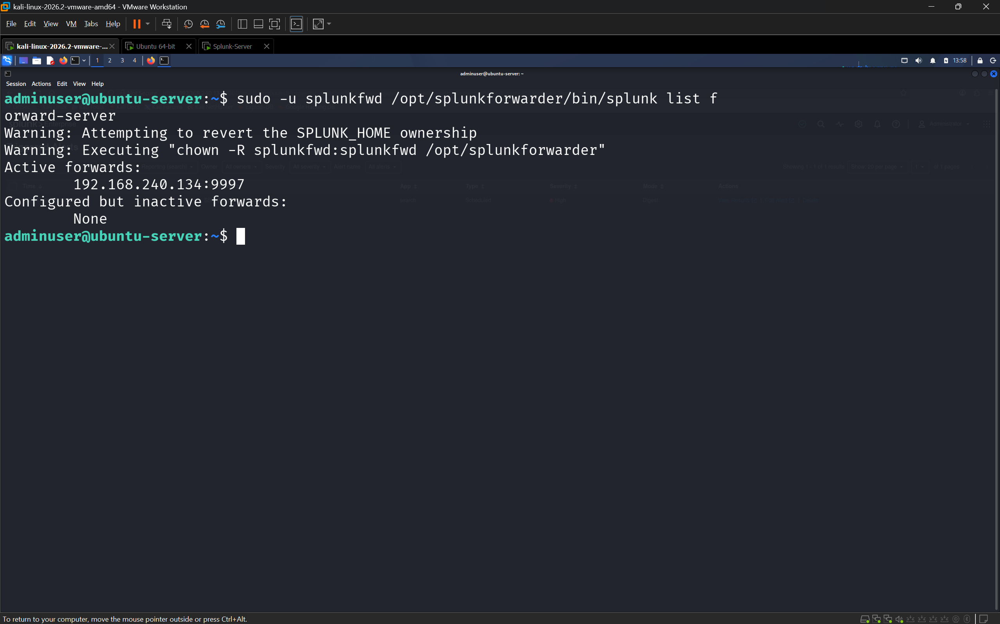
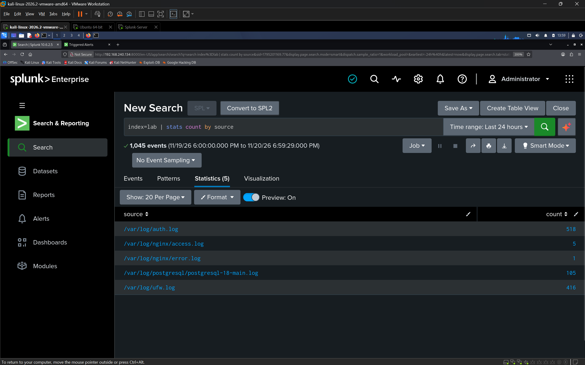

# Splunk SIEM

I added a Splunk Enterprise server to the lab so the logs from the Ubuntu server are collected in one place, searched, charted on a dashboard, and turned into alerts. I then attacked the lab from Kali to check that the detections work.

## Architecture

```text
   Kali (192.168.240.133)                 attacks: nmap, failed SSH logins
            |
            v
   Ubuntu server (192.168.240.132)        generates logs
   Universal Forwarder (SplunkForwarder)
            |   TCP 9997
            v
   Splunk server (192.168.240.134)        index "lab", dashboard, alerts
   Web UI on port 8000 (Kali only)
```

All three VMs are on the isolated VMware host-only network (192.168.240.0/24).

| VM | IP | Role |
|---|---|---|
| Kali Linux | .133 | Attacker and Splunk web UI client |
| `ubuntu-server` | .132 | Log source with the Universal Forwarder |
| `splunk-server` | .134 | Splunk Enterprise 10.6.2.5 |

## What gets collected

The forwarder monitors five files on the Ubuntu server and sends them to the `lab` index. See `configs/inputs.conf.example`.

| Source | Sourcetype | Used for |
|---|---|---|
| `/var/log/auth.log` | `linux_secure` | SSH logins and failures |
| `/var/log/nginx/access.log` | `access_combined` | Web requests and status codes |
| `/var/log/nginx/error.log` | `nginx_error` | Web server errors |
| `/var/log/postgresql/postgresql-18-main.log` | `postgresql` | Database login failures |
| `/var/log/ufw.log` | `ufw` | Blocked connections (port scans) |




## Setup summary

1. Created the `splunk-server` VM and gave it a static IP (.134).
2. Locked the VM down with UFW: SSH and port 8000 only from Kali, port 9997 only from the Ubuntu server, default deny incoming (`configs/ufw-rules.example`).
3. Installed Splunk Enterprise from the `.tgz` archive under a dedicated `splunk` user and enabled boot-start with systemd. The `.deb` package failed on this VM (see `troubleshooting.md`).
4. Created the `lab` index and enabled receiving on port 9997.
5. Installed the Universal Forwarder on the Ubuntu server under its own `splunkfwd` user, pointed it at `192.168.240.134:9997` (`configs/outputs.conf.example`), and added the five
